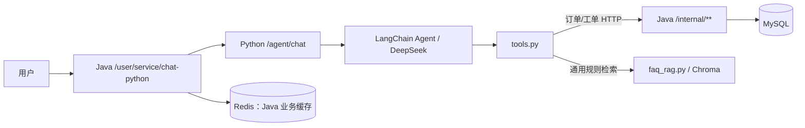

# 禾巷餐饮 · 智能点餐与售后平台

“禾巷餐饮”是本项目的**演示品牌名**，不是对源码来源的重新归属：项目以黑马程序员《苍穹外卖》课程后端为学习基础，并复用了资料中的旧“瑞吉外卖”前端编译产物；在此基础上扩展了 Java/Python 售后 Agent、工单、FAQ 检索、评测与本地前端适配。Java 服务负责订单、工单、用户身份及数据库访问；Python 服务用 LangChain Agent 调用售后工具，并通过 FAQ 向量检索回答通用规则问题。仓库提供 Docker Compose 演示编排、Java 测试、Python 自检与评测数据集。

项目面向学习和实习面试展示，**不是生产就绪系统**。本仓库的默认账号、令牌和数据库密码只用于本地演示，不应直接用于公网部署。

## 项目结构与调用链



Java 还提供独立的 AI 点餐助手 `/user/ai/chat`：它使用菜单快照、Redis 会话与后端业务校验；它和 Python 售后 Agent 是两条不同的实现路径。Python Agent 的四个工具为 `query_orders`、`query_order_detail`、`create_ticket`、`query_faq`。订单和工单以 Java/MySQL 为事实来源；FAQ 来自仓库的规则数据与 Chroma 索引。

主要目录：

| 路径 | 用途 |
| --- | --- |
| `sky-server/` | Spring Boot 接口、业务服务、Java 测试 |
| `sky-common/`、`sky-pojo/` | 公共代码与数据对象 |
| `python-agent/` | FastAPI 入口、Agent、工具、FAQ RAG、Python 测试 |
| `python-agent/eval/` | 版本化评测集、评测脚本、Bad Case 工作流 |
| `docker/`、`docker-compose.yml` | 镜像构建与演示种子数据 |
| `docs/agent-learning/` | 可离线打开的 Agent 源码学习工作台 |
| `frontend/` | 旧小程序工作副本、售后 Agent 小程序页、商家工单页及本地演示说明；不是生产前端 |

想体验旧后台与当前 Agent 的前端接入，请先阅读 [本地前端演示说明](frontend/README.md)。后台旧构建文件仍在课程资料目录，当前仓库没有把旧页面冒称为从零开发的管理端；对外显示的品牌名由本地适配层改为“禾巷餐饮”。仓库目录、Maven 模块、Java 包、Docker 服务与数据库仍保留原有 `sky-*` 技术标识，以免破坏既有部署和历史学习记录；品牌改名不等于技术标识迁移。

## 本地演示：Docker Compose

需要 Docker Desktop / Docker Compose；首次构建 Python 镜像和准备 bge-m3 模型需要较多磁盘空间与下载时间。以下命令在仓库根目录执行：

```powershell
Copy-Item python-agent/.env.example python-agent/.env
```

编辑 `python-agent/.env`，填写你自己的 `DEEPSEEK_API_KEY`。Compose 会把 `JAVA_BASE_URL` 改为容器服务地址，并把 `MOCK_JAVA` 改为 `0`。`INTERNAL_TOKEN` 必须与 Compose 中 Java 服务的 `INTERNAL_TOKEN` 一致；当前两处模板值仅用于本地演示。`.env` 被 Git 忽略，不能提交。

```powershell
docker compose config --quiet
docker compose up -d --build
docker compose ps
```

端口：Java `localhost:8080`，Python Agent `127.0.0.1:8000`，MySQL 宿主 `3307`，Redis 宿主 `6379`。Python 端口仅映射到宿主回环地址。检查 Agent 存活：

```powershell
Invoke-RestMethod http://127.0.0.1:8000/health
```

开发配置允许未登录的 AI 演示请求使用演示用户 1。运行中的真实问答示例：

```powershell
$body = @{ message = '我的订单有哪些？'; sessionId = 'readme-demo' } | ConvertTo-Json
Invoke-RestMethod -Method Post -Uri http://localhost:8080/user/service/chat-python -ContentType 'application/json; charset=utf-8' -Body $body
```

这一步会调用真实模型，产生模型服务费用；若未配置密钥，Python 会返回配置提示。演示数据只在 MySQL 数据卷**首次为空**时依次由 `sky-take-out.sql`、`docker/seed/02-sample-data.sql` 和 `docker/seed/03-legacy-catalog.sql` 初始化；第三个脚本只追加旧菜品目录，不导入旧用户或订单。不要为“重置演示”随手运行 `docker compose down -v`：`-v` 会删除 MySQL 数据卷。普通停止用 `docker compose down`，保留数据卷。

## 验证与评测

Java 测试（需本机 Maven/JDK，或在构建环境中执行）：

```powershell
mvn test
```

Python 自检在已启动的 Python 容器内可运行；它会在导入工具前启用 Mock，不写真实工单：

```powershell
docker compose exec python-agent python selftest.py
```

FAQ 检索烟雾测试会加载 bge-m3 与 Chroma，首次运行可能较慢：

```powershell
docker compose exec python-agent python test_faq_rag.py
```

评测集先从不调用模型的校验开始：

```powershell
python python-agent/eval/run_eval.py --validate
```

在 `python-agent` 目录执行无网络的评测器与工具契约测试：

```powershell
python -m unittest discover -s eval -p "test_*.py" -v
```

真实模型评测需在安装了 `python-agent/requirements.txt` 及 RAG 依赖的本机 Python 环境中运行，且 `python-agent/.env` 配有密钥；运行前先阅读 [评测说明](python-agent/eval/README.md)。评测脚本强制使用 `MOCK_JAVA=1`，不会调用 Java 或写 MySQL，但会产生模型调用费用。报告默认保存在被 Git 忽略的 `python-agent/eval/runs/`，失败候选需人工核实后再记入 Bad Case。

真实 Java/MySQL 联调可先运行只读的 `python-agent/eval/real_preflight.py`（命令和证据边界见[评测说明](python-agent/eval/README.md)）。旧 `python-agent/accept_e2e.py` 写死历史订单号且会写工单，现默认拒绝运行。当前新增[两轮真实链路脚本](python-agent/eval/real_chat_smoke.py)，能从 Java 用户入口复现查单→追问明细；它调用真实模型，只适合隔离演示环境，并非全量生产 E2E。工单幂等的受控写入脚本和清理说明见[复现与面试讲解](docs/agent-learning/05-三项改进复现与面试讲解.md)。

若容器内 Maven 首次下载依赖很慢，而本机 Maven 已有依赖，可先在仓库根目录执行 `mvn -pl sky-server -am package -DskipTests`，再执行 `docker build --build-context localjar=./sky-server/target -f Dockerfile.java.local -t sky-take-out-java:1.0 .` 和 `docker compose up -d --no-deps --no-build --force-recreate java-app`。这是使用本机构建产物的**联调捷径**，不替代默认 `Dockerfile.java` 的可复现构建；改了 Java 源码后必须重新编译并打镜像。

## 已知限制与下一步

2026-10-17 定点修复：售后响应新增 `outcome=completed/unknown`，未知结果与缺失状态不会清除网页/小程序的待重试 ID。重试先调用只读 `GET /user/service/ticket-result?requestId=原ID`，Java 以可信身份查询已提交工单，找到后直接返回原工单号，不重跑模型；暂无记录时才沿用原 ID 重发。`completed` 表示本轮处理结束，不表示退款/补送成功。Java 44 项、Python eval 29 项及前端脚本回归通过，但未做当前 Docker 部署与真实写后丢包验收；原 `test_faq_rag.py` 仍有 30/13 条的过期断言。学习说明与完整方法已整合到[工作台工单章](docs/agent-learning/01-tools离线学习工作台.html#ticket)。

同日第二轮补上新建工单的订单归属校验：非空订单号必须存在且属于可信用户；不存在/非本人统一拒绝，不会自动取消关联后继续写库。无订单的通用反馈仍可登记。已有同 ID、同载荷工单优先恢复，不依赖当前订单状态，数据库唯一约束继续兜底并发写入。最新 Java 54 项、Python eval 29 项及前端自检通过，属于无真实数据库的回归；没有迁移历史非法关联或重建运行镜像。学习工作台新增完整 Java 建单方法与 T8～T10。

- `InMemorySaver` 只保存当前 Python 进程的会话状态；进程重启后聊天历史丢失。Chroma 持久化的是 FAQ 索引，不是聊天记忆。
- `agent.py run()` 现只提取最后一条 `HumanMessage` 之后的 `ToolMessage`；无网络测试和真实两轮读链路已验证不再混入历史工具。评测脚本同样按本轮切分。
- 工单改为随机号，并由 MySQL `UNIQUE(user_id, request_id)` 保证同一用户发送动作的写入幂等；同 ID 不同内容返回冲突。**跨 HTTP 请求重试时客户端必须复用 requestId**；未传时每次由 Java 生成新值，仍不能防跨请求重复。真实支付/退款不在此幂等范围。
- 订单详情对不存在和非本人订单分别返回 404/403，可区分订单号是否存在。FAQ 检索失败现在明确说无法核实规则，但模型最终回复仍需评测。
- 原 30 条演示 FAQ 的若干政策与后端能力不符或无法证实；默认换成 13 条保守问答与独立索引。详见[FAQ 能力对账](docs/agent-learning/04-FAQ能力对账与面试复盘.md)。真实运营政策仍需业务方确认，不能把“后端没找到”冒充最终政策。
- Docker 与开发 Profile 含演示用配置；正式部署前须移除默认凭据、核对已提交过的配置并轮换任何真实密钥。不要把演示身份和服务令牌当作生产安全方案。
- 已有固定提交的真实模型 + Mock Java 全量评测；当前工作区增加可重复的真实两轮读链路脚本、Java/MySQL 工单幂等集成抽样和 FAQ 单例抽样。仍缺真实用户 JWT、真实网络丢包/并发故障、完整业务政策审核及生产级监控；`needs_review` 不能算自动通过，不能宣称“生产级 Agent”。

学习路径从 [离线工具层工作台](docs/agent-learning/01-tools离线学习工作台.html) 开始；每章顶部直接展示完整真实方法，再按执行顺序讲解、闭卷复述和修改。只有提交代码改动与测试证据，才算达到 L3“能改”。随后可用 [Agent 评测学习复盘](docs/agent-learning/02-Agent评测学习复盘.md) 练习解释“测到了什么、尚未证明什么”。


## 展示分支说明

此分支是2026-11-08本地项目的完整源码展示快照，独立于旧版提交历史。未包含本地`.env`、模型权重、向量缓存及原始运行记录。开发配置中的微信及对象存储凭据改为读取`WECHAT_SECRET`、`OSS_ACCESS_KEY_ID`、`OSS_ACCESS_KEY_SECRET`环境变量，使用相应功能前需自行配置。本次发布仅核对源码和配置，不代表重新完成真实模型或生产部署验收。
